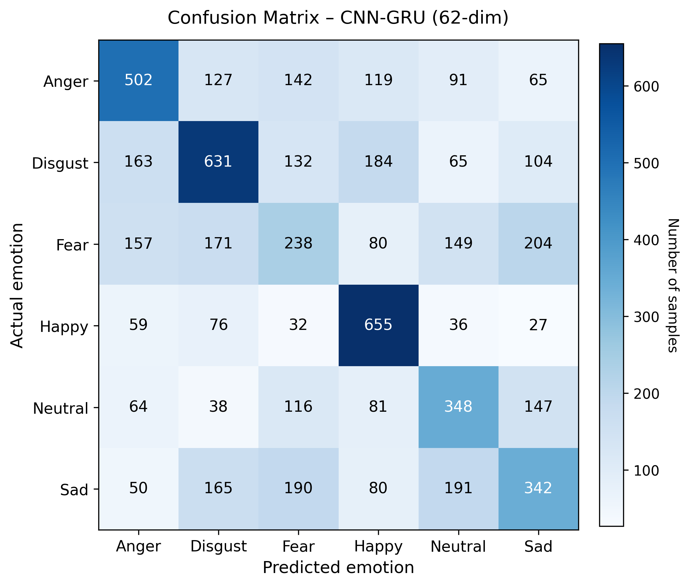

# LipMotion-Emotion-Recognition

Privacy-preserving emotion recognition from inner-lip motion dynamics using CNN and CNN–GRU architectures.

---

## Overview

This project investigates whether emotional expression can be recognized from **inner-lip motion alone** while minimizing biometric identity leakage.

Instead of using full-face imagery, the system operates only on:

* inner-lip landmarks
* mouth aspect ratio (MAR)
* temporal lip motion dynamics

This constrained representation reduces access to identity-related facial information while preserving emotion-relevant motion patterns.

The repository includes:

* handcrafted feature baselines
* 1D-CNN models
* CNN–GRU temporal architectures
* speaker-independent evaluation
* privacy leakage analysis

---

## Key Results

| Model                |  Accuracy |
| -------------------- | --------: |
| MLP baseline         |     36.0% |
| 1D-CNN (60-dim)      |     42.8% |
| 1D-CNN (62-dim)      |     44.6% |
| **CNN–GRU (62-dim)** | **45.1%** |

<p align="center">
  
  <br/><em>Confusion matrix of the best CNN‑GRU model.</em>
</p>

### Privacy Evaluation

| Task                   | Accuracy |
| ---------------------- | -------: |
| Emotion recognition    |    45.1% |
| Speaker identification |     0.0% |

The learned representation preserves emotional information while failing to generalize speaker identity to unseen individuals.

---

# Method

## Feature Extraction

Each frame is represented using:

* 20 inner-lip landmarks (60 dimensions)
* Mouth Aspect Ratio (MAR)
* inter-frame motion magnitude

Resulting in a:

```text id="r9q7lq"
62-dimensional feature vector
```

Videos are segmented into:

```text id="5vq4m7"
30-frame windows with 50% overlap
```

---

## Model Architecture

The best-performing model combines:

* 1D convolutional feature extraction
* bidirectional GRU temporal modeling
* fully connected emotion classification


---

# Dataset

Dataset: [CREMA-D](https://github.com/CheyneyComputerScience/CREMA-D)

* 7,442 video clips
* 91 speakers
* 6 emotions

Speaker-independent split:

* 72 speakers for training
* 19 speakers for testing

---

# Results

## Emotion Recognition

| Emotion | Precision | Recall |   F1 |
| ------- | --------: | -----: | ---: |
| Anger   |      0.50 |   0.48 | 0.49 |
| Disgust |      0.52 |   0.49 | 0.51 |
| Fear    |      0.28 |   0.24 | 0.26 |
| Happy   |      0.55 |   0.74 | 0.63 |
| Neutral |      0.40 |   0.44 | 0.42 |
| Sad     |      0.38 |   0.34 | 0.36 |

---

## Key Observations

* Happy is recognized strongly due to distinctive mouth motion patterns.
* Fear remains challenging because it relies heavily on upper-face cues.
* Temporal modeling improves subtle emotion recognition.
* Handcrafted MAR/motion features improve performance over raw landmarks alone.

---

# Installation

```bash
pip install -r requirements.txt
```

Required dependencies:

```text id="fx0g4i"
torch
numpy
pandas
opencv-python
mediapipe
scikit-learn
tqdm
```

Download the MediaPipe:

```text id="2rx0yb"
face_landmarker.task
```

model and place it in the project directory.

---

# Usage

Place CREMA-D videos inside:

```text id="9ysih6"
data/raw/
```

Run the pipeline:

```bash
python src/build_metadata.py
python src/windowing.py
python src/split_data.py
python src/train_model.py
python src/train_cnn_gru.py
python src/privacy_leakage.py
```

---

# Repository Structure

```text id="9yqbgv"
.
├── data/
├── src/
├── results/
├── requirements.txt
└── README.md
```

---

# Privacy Perspective

Traditional facial emotion recognition systems often expose substantial biometric information.

This project explores whether emotion-related dynamics can remain useful under strong identity constraints by limiting the representation to inner-lip motion only.

The goal is not perfect accuracy, but improved privacy-preserving affective computing.

---

# Future Work

Potential extensions include:

* transformer-based temporal architectures
* adversarial privacy training
* multimodal fusion with audio
* real-time inference
* cross-dataset evaluation
* explainability analysis

---

# Citation

```bibtex id="l4gtc5"
@misc{norouzi2026lipmotion,
  title={Lip-Motion Emotion Recognition with Privacy Evaluation},
  author={Sepideh Norouzi Motlagh},
  year={2026},
  note={GitHub repository}
}
```

---

# Author

Sepideh Norouzi Motlagh

GitHub: @SepidehNorouziMotlagh
